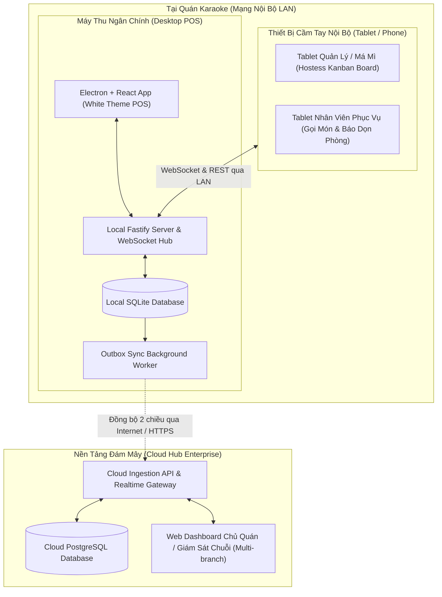
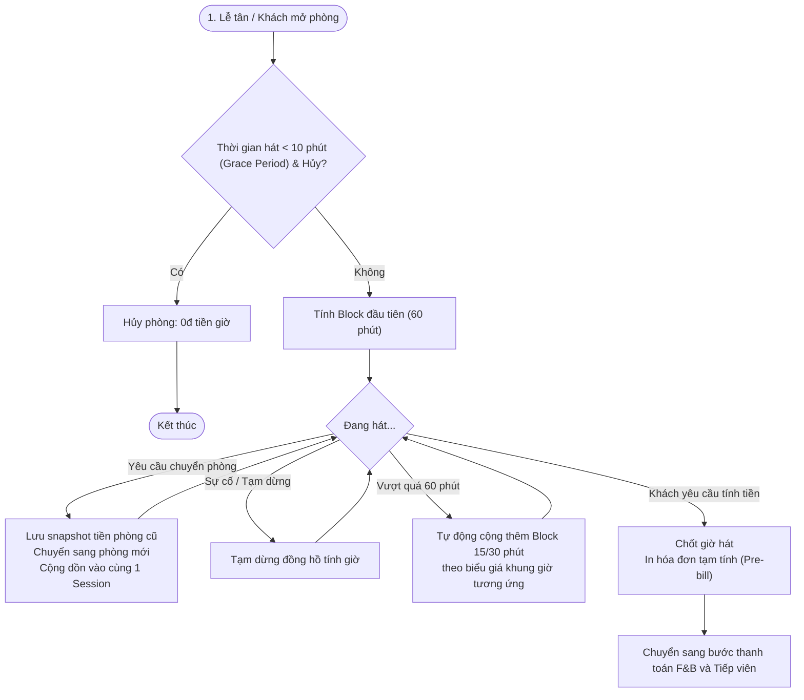
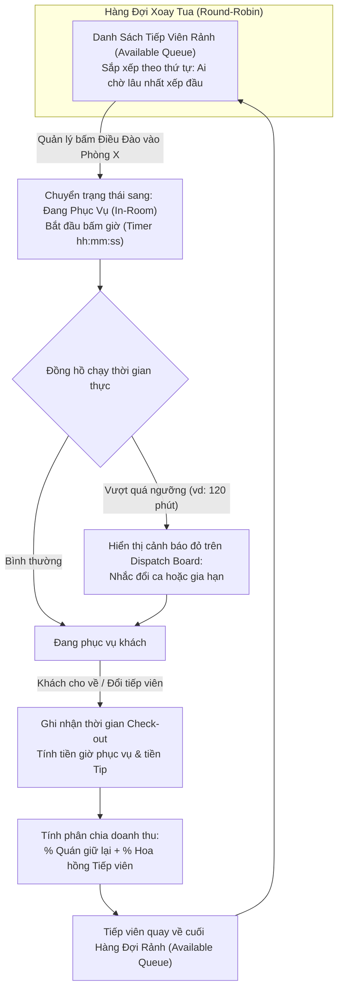
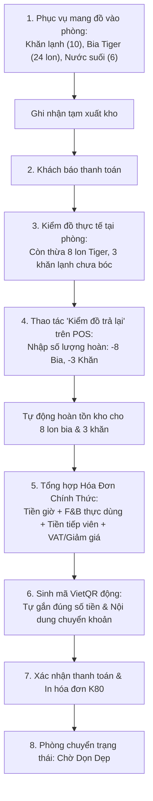

# Karaoke Hub Enterprise - Bản Thiết Kế Kiến Trúc & Đặc Tả Nghiệp Vụ (Phase 1)

> **Dự án**: Karaoke Hub Enterprise  
> **Mục tiêu**: Hệ thống quản lý phòng hát, danh mục thu ngân & tiếp viên Karaoke đồng bộ đám mây thời gian thực với cơ chế Offline-first.  
> **Giao diện**: Chuẩn White Theme hiện đại, tương phản sắc nét, tối ưu cho môi trường quầy thu ngân và máy tính bảng.

---

## 1. Sơ Đồ Kiến Trúc Hệ Thống (System Architecture)

Hệ thống hoạt động theo mô hình **Dual-Layer Hybrid**:
1. **Lớp Local LAN (Tại quán)**: Máy POS trung tâm làm Local Hub (Node.js/Fastify WebSocket Server). Các máy tính bảng của nhân viên/quản lý kết nối trực tiếp qua mạng WiFi nội bộ, phản hồi với độ trễ gần như 0ms kể cả khi mất Internet hoàn toàn.
2. **Lớp Cloud Hub (Đám mây)**: Máy POS chạy một Background Outbox Worker đẩy các sự kiện (Room sessions, Orders, Hostess logs, Invoices) lên Cloud khi có Internet để chủ cơ sở theo dõi báo cáo từ xa.



---

## 2. Các Sơ Đồ Quy Trình Nghiệp Vụ (Workflow Diagrams)

### 2.1. Quy Trình Tính Tiền Giờ Phòng Hát (Room Billing Engine)



---

### 2.2. Quy Trình Bảng Điều Phối Tiếp Viên (Hostess Dispatch & Round-Robin)



---

### 2.3. Quy Trình Thu Ngân & Kiểm Đồ Trả Lại (Cashier & Return Items)



---

## 3. Bản Phác Thảo Giao Diện Trực Quan (Visual Mockups - White Theme)

### Mockup 1: Màn Hình Chính Thu Ngân POS (Room Matrix & Order Panel)

```
+---------------------------------------------------------------------------------------------------------------------------+
|  [H] KARAOKE HUB ENTERPRISE     [Phong Hat]   [Dieu Phoi Tiep Vien]   [Kho & Thuc Don]   [Bao Cao]   |  16:45  [Admin (Pos 01)] |
+---------------------------------------------------------------------------------------------------------------------------+
| [Tat Ca (18)]  [Dang Hat (7)]  [Trong (8)]  [Cho Don (2)]  [Dat Truoc (1)]              |  CHI TIET PHONG: VIP 02                 |
+-----------------------------------------------------------------------------------------+-----------------------------------------+
| +-------------------+ +-------------------+ +-------------------+ +-------------------+ | Khach: Anh Minh (0912.xxx.xxx)           |
| | PHONG 101 (STD)   | | PHONG 102 (STD)   | | VIP 01 (VIP)      | | VIP 02 (VIP)  [*] | | Gio vao: 14:15  | Thoi gian: 02h 30m   |
| | TRONG             | | DANG HAT          | | TRONG             | | DANG HAT        | | Tien gio tam tinh:         450.000 d    |
| | 150k/h            | | 01h 15m - 187k    | | 220k/h            | | 02h 30m - 450k  | +-----------------------------------------+
| | [ Nhan Phong ]    | | 2 Tiep vien       | | [ Nhan Phong ]    | | 3 Tiep vien     | | TIEP VIEN DANG PHUC VU:               |
| +-------------------+ +-------------------+ +-------------------+ +-------------------+ | * Mai Linh (02h15m)            300.000 d  |
| +-------------------+ +-------------------+ +-------------------+ +-------------------+ | * Thu Huong (01h45m)           250.000 d  |
| | VIP 03 (SUPER)    | | PHONG 201 (STD)   | | PHONG 202 (STD)   | | PHONG 203 (PARTY) | | * Kim Anh (00h45m)             150.000 d  |
| | CHO DON DEP       | | DANG HAT          | | DAT TRUOC         | | DANG HAT        | +-----------------------------------------+
| | Don phong 10m     | | 00h 45m - 112k    | | 18:30 (A. Nam)    | | 03h 10m - 950k  | | F&B / THUC DON GOI:                    |
| | [ Da Don Xong ]   | | [ Xem Chi Tiet ]  | | [ Nhan Phong ]    | | 4 Tiep vien     | | 1. Bia Heineken (Silver) x 16   480.000 d  |
| +-------------------+ +-------------------+ +-------------------+ +-------------------+ | 2. Dia Trai Cay Dac Biet x 1     250.000 d  |
| +-------------------+ +-------------------+ +-------------------+ +-------------------+ | 3. Khan Lanh x 12                 60.000 d  |
| | VIP 05 (VIP)      | | PHONG 204 (STD)   | | PHONG 205 (STD)   | | PHONG 301 (SUPER) | | 4. Kho Bo xe cay x 2           180.000 d  |
| | TRONG             | | DANG HAT          | | TRONG             | | DANG HAT        | +-----------------------------------------+
| | 220k/h            | | 01h 50m - 275k    | | 150k/h            | | 01h 05m - 325k  | | Tong Tien Gio:              450.000 d  |
| | [ Nhan Phong ]    | | [ Xem Chi Tiet ]  | | [ Nhan Phong ]    | | [ Xem Chi Tiet ]| | Tong F&B:                   970.000 d  |
| +-------------------+ +-------------------+ +-------------------+ +-------------------+ | Tong Tiep Vien:               700.000 d  |
|                                                                                         | ----------------------------------------- |
|                                                                                         | TONG CONG:                  2.120.000 d  |
|                                                                                         | +---------------------------------------+ |
|                                                                                         | | [ + Goi Mon ]   [ Kiem Do Tra Lai ]   | |
|                                                                                         | | [ Chuyen Phong] [ In Tam Tinh (Pre) ] | |
|                                                                                         | | [ THANH TOAN VIETQR & TIEN MAT ]      | |
|                                                                                         | +---------------------------------------+ |
+-----------------------------------------------------------------------------------------+-----------------------------------------+
```

---

### Mockup 2: Bảng Điều Phối Tiếp Viên Thời Gian Thực (Dispatch Kanban Board)

```
+---------------------------------------------------------------------------------------------------------------------------+
|  [H] BANG DIEU PHOI TIEP VIEN (DISPATCH KANBAN)                                              Loc: [Tat ca to / Nhom v]     |
+---------------------------------------------------------------------------------------------------------------------------+
|  SAN SANG / XOAY TUA (8)                  |  DANG PHUC VU PHONG (12)                 |  NGHI TAM / OFF-DUTY (3)           |
+-------------------------------------------+------------------------------------------+------------------------------------+
|  [!] Hang doi uu tien theo gio ranh lau   |  * VIP 02 (3 Tiep vien)                  |  * Ngoc Anh                        |
|                                           |    - Mai Linh   [02h 15m] [!] QUA GIO    |    Ly do: An toi                   |
|  1. Lan Huong (To 1)                      |    - Thu Huong  [01h 45m]                |    Ranh lai: 17:30                 |
|     Ranh tu: 14:00 (165 phut)             |    - Kim Anh    [00h 45m]                |    [ Dua Vao Hang Doi ]            |
|     Luot hom nay: 2 ca                    |    [ + Dieu Them ] [ Doi Dao ]           |                                    |
|     [ Dieu Vao Phong v ]                  |                                          |  * Bich Tuyen                      |
|                                           |  * Phong 102 (2 Tiep vien)               |    Nghi phep co ly do              |
|  2. Hoang Yen (To 2)                      |    - Thao Nhi   [01h 15m]                |                                    |
|     Ranh tu: 14:30 (135 phut)             |    - Phuong Thao[01h 15m]                |  * Ha My                           |
|     Luot hom nay: 1 ca                    |    [ + Dieu Them ] [ Doi Dao ]           |    Het ca lam viec                 |
|     [ Dieu Vao Phong v ]                  |                                          |                                    |
|                                           |  * Phong 203 (4 Tiep vien)               |                                    |
|  3. Diem My (To 1)                        |    - Kieu Oanh  [03h 10m] [!] CANH BAO   |                                    |
|     Ranh tu: 15:10 (95 phut)              |    - Bao Ngoc   [02h 45m]                |                                    |
|     Luot hom nay: 3 ca                    |    - Yen Nhi    [01h 20m]                |                                    |
|     [ Dieu Vao Phong v ]                  |    - Tu Quynh   [00h 30m]                |                                    |
|                                           |    [ + Dieu Them ] [ Doi Dao ]           |                                    |
|  4. Quynh Chi (To 3)                      |                                          |                                    |
|     Ranh tu: 16:00 (45 phut)              |  * Phong 301 (1 Tiep vien)               |                                    |
|     Luot hom nay: 0 ca                    |    - Cam Tu     [01h 05m]                |                                    |
|     [ Dieu Vao Phong v ]                  |                                          |                                    |
+-------------------------------------------+------------------------------------------+------------------------------------+
```

---

### Mockup 3: Modal "Kiểm Đồ Trả Lại" & Thanh Toán VietQR Động

```
+-------------------------------------------------------------------------------+
| KIEM DO TRA LAI & THANH TOAN - PHONG VIP 02                               [X] |
+-------------------------------------------------------------------------------+
|  Danh muc F&B da xuat         Da mang ra    Thuc dung    Tra lai kho    Thanh tien |
|  ---------------------------------------------------------------------------- |
|  1. Bia Heineken Silver       24 lon        16 lon       [ -8  ] lon    480.000 d  |
|  2. Nuoc suoi Aquafina         6 chai        2 chai      [ -4  ] chai    30.000 d  |
|  3. Khan lanh                  15 cai       12 cai       [ -3  ] cai     60.000 d  |
|  4. Dia Trai Cay Dac Biet       1 dia        1 dia       [  0  ] dia    250.000 d  |
|  5. Kho Bo xe cay               2 dia        2 dia       [  0  ] dia    180.000 d  |
|                                                                               |
|  Tong F&B thuc te sau hoan:                                      1.000.000 d  |
|  Tien gio phong (02h 30m):                                         450.000 d  |
|  Phi phuc vu tiep vien (3 nguoi):                                  700.000 d  |
|  Giam gia (Voucher VIP 10% F&B):                                  -100.000 d  |
|  ---------------------------------------------------------------------------- |
|  TONG THANH TOAN:                                                2.050.000 d  |
|                                                                               |
|  +-------------------------------------+   PHUONG THUC THANH TOAN:            |
|  |       [ QUET MA VIETQR DONG ]       |                                      |
|  |    +-------------------------+      |   (o) Chuyen khoan VietQR Tu Dong    |
|  |    |  ######  #   ##  ###### |      |   ( ) Tien mat                       |
|  |    |  #    #  ##  #   #    # |      |   ( ) The POS (Visa/Mastercard)      |
|  |    |  ######  # # ##  ###### |      |                                      |
|  |    |  #    #  #   #   #    # |      |   Ngan hang: MB BANK - 9999988888    |
|  |    |  ######  ### ##  ###### |      |   So tien: 2.050.000 VND             |
|  |    +-------------------------+      |   Noi dung: KTVIP02 THANHTOAN        |
|  |      Nhan dien thanh toan 24/7      |                                      |
|  +-------------------------------------+   [ ] In Kem Hoa Don Dien Tu (K80)   |
|                                                                               |
|  [ Huy Bo ]                           [ IN PRE-BILL ]   [ XAC NHAN HOAN TAT ] |
+-------------------------------------------------------------------------------+
```

---

## 4. Thiết Kế Cơ Sở Dữ Liệu Thực Thể (Database Schema)

### Các Bảng Cốt Lõi (Core Tables)
- `rooms`: ID, code, name, room_type (STANDARD, VIP, PARTY), hourly_rate, status (AVAILABLE, OCCUPIED, CLEANING, RESERVED).
- `room_sessions`: ID, room_id, customer_name, customer_phone, check_in_time, check_out_time, total_minutes, room_charge, status (ACTIVE, COMPLETED, CANCELLED).
- `hostesses`: ID, code, full_name, team_name, phone, status (AVAILABLE, IN_ROOM, OFF_DUTY), current_room_id, last_available_at.
- `hostess_session_logs`: ID, room_session_id, hostess_id, check_in_time, check_out_time, hourly_rate, tip_amount, commission_rate, total_fee.
- `menu_items`: ID, code, name, category, unit, unit_price, stock_quantity.
- `order_items`: ID, room_session_id, menu_item_id, quantity_dispatched, quantity_returned, quantity_consumed, unit_price, total_price.
- `invoices`: ID, room_session_id, invoice_code, total_room_charge, total_fnb_charge, total_hostess_charge, discount_amount, final_amount, payment_method (VIETQR, CASH, CARD), is_paid, created_at.
- `sync_outbox`: ID, event_type, payload_json, is_synced, retry_count, created_at, synced_at.

---

## 5. Kế Hoạch Triển Khai Phase 1 (MVP Roadmap)

1. **Sprint 1: Core Billing & Domain Engine (TypeScript)**
   - Room Billing Calculator (Block 60m + 15m/30m + Grace period 10m + Room transfer logic).
   - Hostess Round-robin Dispatch Queue Engine.
   - Comprehensive Unit Tests cho toàn bộ logic cốt lõi.

2. **Sprint 2: Local Server & Dual-layer Realtime Sync**
   - Node.js Fastify local server + WebSocket Hub.
   - SQLite Local Database với Outbox sync schema.
   - Mock Cloud Ingestion API để kiểm thử đồng bộ 2 chiều.

3. **Sprint 3: Modern White Theme Desktop POS & Dispatch Kanban**
   - Sơ đồ phòng trực quan, đồng hồ đếm thời gian thực, quản lý trạng thái.
   - Màn hình Bảng điều phối tiếp viên Kanban (Xoay tua, Bấm giờ, Cảnh báo quá giờ).
   - Module Gọi món & Kiểm đồ trả lại (hoàn kho bia/nước).
   - Tích hợp sinh mã VietQR động theo chuẩn Napas247.

4. **Sprint 4: Tích Hợp Đóng Gói & Review 2 Lần**
   - Đóng gói ứng dụng chạy mượt mà trên môi trường Windows.
   - Review mã nguồn 2 lần và kiểm thử hoàn chỉnh các ca nghiệp vụ.
